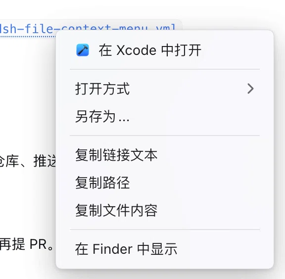

# @dengsixue/dsh-file-menu

> DeepSeek Harness (DSH) 聊天区文件超链接右键上下文菜单增强插件。

[](https://www.npmjs.com/package/@dengsixue/dsh-file-menu)
[](LICENSE)
[](https://github.com/topics/dsh-plugin)

在 DeepSeek Harness 对话区域中，右键点击本地文件超链接、文件引用标签（Chip）、代码块文件路径时，提供类似操作系统原生体验的快捷操作上下文菜单。



---

## ✨ 核心特性

- 🚀 **智能上次使用应用**：顶部第一行记忆上次用来打开该类型文件的应用，一键极速重开。
- 📂 **系统级打开方式**：
  - **Windows**：自动解析系统注册表中的关联应用列表与 `OpenWithList`，使用 PowerShell 高性能批量提取对应高清应用图标。已修复 Electron 环境下外部应用（如 VS Code、Trae CN 等）继承 `ELECTRON_RUN_AS_NODE` 导致的唤起失效问题。
  - **macOS**：通过 LaunchServices 提取与 Finder 完全一致的应用列表与图标。
- 🛡️ **丝滑子菜单防抖**：采用原生级悬停缓冲区与 280ms 延时保护，斜向滑动平滑稳定，杜绝鼠标稍微划偏子菜单就意外消失的问题。
- 💾 **另存为...**：直接呼出系统原生保存对话框，将工作区文件保存至任意自定义目录。
- 📋 **快速复制**：一键复制文件名/链接文本、绝对文件路径、文件内容（支持 5MB 以内文本文件）。
- 🔍 **在资源管理器/Finder 中显示**：直接打开父目录并在资源管理器中精准高亮选中该文件。
- ⚡ **原生快捷穿透**：按住 `Shift` 键再右键，无缝直通操作系统或浏览器原生菜单，完全不破坏原生体验。

---

## 🖥️ 平台兼容性

| 平台 | 打开方式支持 | 图标提取 | 状态 |
| :--- | :--- | :--- | :--- |
| **Windows** | 注册表关联应用 (`HKCU/HKLM`) | PowerShell 批量提取关联图标 | ✅ 已真机适配与环境净化 |
| **macOS** | LaunchServices 动态解析 | 系统原生图标映射 | ✅ 支持 |

> **提示**：Windows 上的部分受限 UWP 沙盒应用（如系统自带简易照片）不会出现在传统打开方式列表中。

---

## 📦 安装与使用

### 方式 1：通过 npm 安装（推荐）

在终端中执行：
```powershell
dsh plugin --profile desktop add @dengsixue/dsh-file-menu
```

### 方式 2：通过 Release / 本地打包安装

1. 从 GitHub Releases 下载最新安装包，或本地打包：
   ```bash
   pnpm pack
   ```
2. 在 DSH Desktop 的「插件」页面选择该 `.tgz` 安装；
   或者命令行安装：
   ```powershell
   dsh plugin --profile desktop add .\dengsixue-dsh-file-menu-1.0.0.tgz
   ```

### 方式 3：本地开发目录链接安装（便于调试）

直接将本地源码目录作为插件加入：
```powershell
dsh plugin --profile desktop add "C:\Users\Administrator\Documents\dsh-file-context-menu"
```

> ⚠️ **重要提示**：安装、更新或修改前端 Client 注入代码后，**必须完全退出并重新打开 DSH Desktop**（重启主进程），仅在界面按 `Ctrl + R` 刷新无法重新加载底层客户端扩展。

---

## 📄 许可证

本项目基于 [MIT 许可证](LICENSE) 开源。
